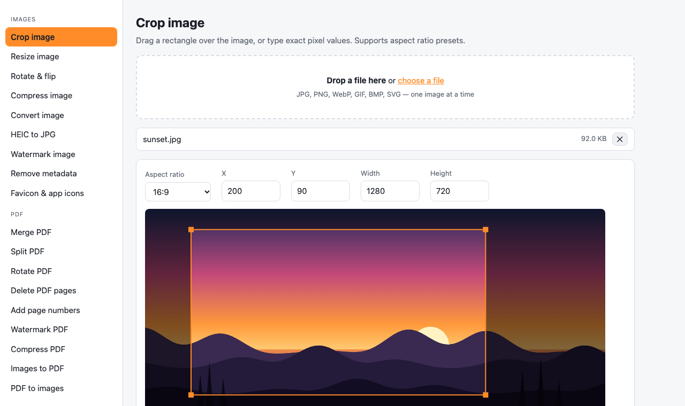

# FileForge

[](https://chromewebstore.google.com/detail/lmnnhcoblacbhagicaambfbbmbpnachn)
[](https://chromewebstore.google.com/detail/lmnnhcoblacbhagicaambfbbmbpnachn)
[](https://addons.mozilla.org/firefox/addon/fileforge-image-pdf-file-tools/)
[](https://addons.mozilla.org/firefox/addon/fileforge-image-pdf-file-tools/)
[](https://github.com/andronaft/FileForge/releases/latest)
[](https://github.com/andronaft/FileForge/actions/workflows/ci.yml)
[](LICENSE)

Local-first file tools for the browser: crop, resize, rotate, compress and convert images (including HEIC), merge/split/rotate PDFs, turn Markdown into PDF, convert CSV ⇄ JSON. 22 tools, everything runs on your device. Nothing is uploaded anywhere.

## Install

| | |
| --- | --- |
| **Chrome, Edge, Brave, Opera** | [Chrome Web Store](https://chromewebstore.google.com/detail/lmnnhcoblacbhagicaambfbbmbpnachn) |
| **Firefox** | [Firefox Add-ons](https://addons.mozilla.org/firefox/addon/fileforge-image-pdf-file-tools/) |
| **Any browser, no install** | [andronaft.github.io/FileForge](https://andronaft.github.io/FileForge/) — installable as an app, works offline |

After installing: click the toolbar icon or press **Alt+Shift+F**, right-click any image → **Edit image in FileForge**, or right-click a PDF link → **Open PDF in FileForge**.



## Tools

| Group | Tool | What it does |
| --- | --- | --- |
| Images | Crop | Drag a rectangle or type exact pixels, aspect-ratio presets |
| Images | Resize | Presets (4K, Full HD, HD…), pixels or percent, batch, keeps aspect ratio |
| Images | Rotate & flip | 90° / 180° / 270°, mirror horizontally or vertically, batch |
| Images | Compress | Quality slider, target size in KB, optional max dimension, shows how much was saved |
| Images | Convert | JPEG ⇄ PNG ⇄ WebP (GIF, BMP, SVG, AVIF accepted as input) |
| Images | HEIC to JPG | iPhone HEIC/HEIF → JPEG, PNG or WebP (libheif in a sandboxed frame) |
| Images | Watermark | Text in a corner, centred, or tiled diagonally, with live preview |
| Images | Remove metadata | Strip EXIF, GPS, XMP, IPTC and comments from JPG/PNG/WebP without re-encoding |
| Images | Favicon & app icons | favicon.ico + PNG set + Apple touch + PWA icons + HTML snippet + webmanifest |
| PDF | Merge | Combine PDFs in the order you choose |
| PDF | Split | Extract page ranges, every page separately, or chunks of N pages |
| PDF | Rotate | All pages or a selection, several files at once |
| PDF | Delete pages | Remove listed pages |
| PDF | Page numbers | Header or footer, several formats, custom start |
| PDF | Watermark | Diagonal text such as DRAFT or CONFIDENTIAL on every page |
| PDF | Compress | Re-renders pages as JPEG at a chosen dpi (ideal for scans) |
| PDF | Images to PDF | One image per page, fit-to-image or A4 / Letter with margins |
| PDF | PDF to images | PNG or JPEG at 72 / 150 / 300 dpi |
| Text & data | Markdown to PDF | Live preview, three stylesheets, A4 / Letter, print-to-PDF or HTML download |
| Text & data | CSV ⇄ JSON | Auto-detects direction and delimiter, handles quoted cells |
| Text & data | JSON format | Pretty / minify, sort keys, points at the exact error position |
| Text & data | Base64 | Encode text or any file (optionally as a data: URL), decode to text or file |

Multiple results can be downloaded as a single ZIP. Images can also be pasted from the clipboard.

## Run from source (unpacked)

1. Open `chrome://extensions` and switch on **Developer mode**.
2. Click **Load unpacked** and choose this folder (for Firefox: `about:debugging` → **Load Temporary Add-on** → `dist/firefox/manifest.json` after `python3 scripts/package.py`).
3. Click the FileForge icon in the toolbar, or right-click an image on any page and pick **Edit image in FileForge**.

The context menu asks for permission to read images from that site only when you first use it. The extension requests no host permissions up front.

## Run as a web app

Any static server works. For example:

```bash
python3 -m http.server 8765
```

Then open `http://localhost:8765/app/index.html`.

## Package for the stores

```bash
python3 scripts/package.py
```

This writes `dist/fileforge-chrome-<version>.zip` and `dist/fileforge-firefox-<version>.zip`. The Firefox build swaps the background service worker for an event page, moves the optional host permission to `optional_permissions`, adds the Gecko add-on id and drops the sandbox page (so HEIC conversion is web-only on Firefox).

## Project layout

```
manifest.json        Chrome extension manifest (Manifest V3)
background.js        Service worker: toolbar button + image context menu
app/index.html       The app shell
app/app.js           Router, drop zone, file list, results
app/util.js          Shared helpers (download, zip, page ranges, widgets)
app/tools/image.js   Canvas-based image pipeline and the five image tools
app/tools/pdf.js     PDF tools built on pdf-lib
app/tools/markdown.js Markdown → PDF / HTML using marked
app/tools/data.js    CSV ⇄ JSON, JSON format, Base64
app/heic-sandbox.*   Sandboxed page that runs heic2any (needs eval)
scripts/package.py   Builds Chrome and Firefox zips
vendor/              pdf-lib, fontkit, pdf.js, marked, JSZip, heic2any, Noto Sans subset (vendored, no build step)
icons/               Extension icons (generated by scripts/make_icons.py)
```

No build step, no framework, no dependencies to install.

## Limits

- Everything runs in browser memory. Very large files (hundreds of MB) may be slow or fail.
- "Compress PDF" rasterises pages, so text stops being selectable. Use it for scans and photo PDFs.
- HEIC conversion needs the sandboxed page, which Firefox extensions do not support; the web version works everywhere.
- DOCX ⇄ PDF is not implemented (needs a server-side converter).

## Web version

<https://andronaft.github.io/FileForge/> is the same app without the extension parts, deployed from `main`
by the [pages workflow](.github/workflows/pages.yml). The privacy policy the stores link to is
<https://andronaft.github.io/FileForge/privacy.html>.

## Publishing

See [docs/PUBLISHING.md](docs/PUBLISHING.md): a `vX.Y.Z` tag (or **Actions → release → Run workflow**)
builds both zips, creates a [GitHub Release](https://github.com/andronaft/FileForge/releases) and submits them
to the [Chrome Web Store](https://chromewebstore.google.com/detail/lmnnhcoblacbhagicaambfbbmbpnachn) and [addons.mozilla.org](https://addons.mozilla.org/firefox/addon/fileforge-image-pdf-file-tools/).
Store listing text: [docs/store-listing.md](docs/store-listing.md); changes per version: [CHANGELOG.md](CHANGELOG.md).

## Privacy

See [PRIVACY.md](PRIVACY.md). Short version: no uploads, no accounts, no analytics.

## Third-party licenses

- [pdf-lib](https://github.com/Hopding/pdf-lib) — MIT
- [marked](https://github.com/markedjs/marked) — MIT
- [JSZip](https://github.com/Stuk/jszip) — MIT or GPLv3
- [pdf.js](https://github.com/mozilla/pdf.js) — Apache 2.0
- [heic2any](https://github.com/alexcorvi/heic2any) — MIT (bundles libheif, LGPL)
