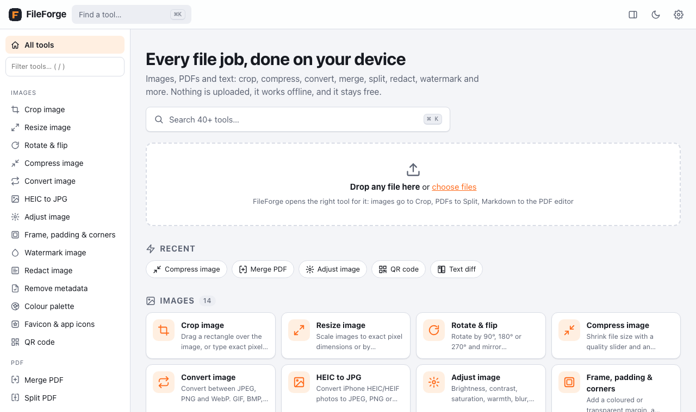
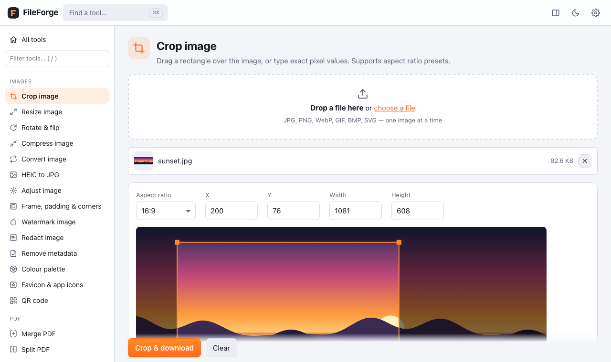

# FileForge

[](https://chromewebstore.google.com/detail/lmnnhcoblacbhagicaambfbbmbpnachn)
[](https://chromewebstore.google.com/detail/lmnnhcoblacbhagicaambfbbmbpnachn)
[](https://addons.mozilla.org/firefox/addon/fileforge-image-pdf-file-tools/)
[](https://addons.mozilla.org/firefox/addon/fileforge-image-pdf-file-tools/)
[](https://github.com/andronaft/FileForge/releases/latest)
[](https://github.com/andronaft/FileForge/actions/workflows/ci.yml)
[](LICENSE)

Local-first file tools for the browser: crop, resize, rotate, compress and convert images (including HEIC), merge/split/rotate PDFs, turn Markdown into PDF, convert CSV ⇄ JSON. 85 tools, everything runs on your device. Nothing is uploaded anywhere.

## Install

| | |
| --- | --- |
| **Chrome, Edge, Brave, Opera** | [Chrome Web Store](https://chromewebstore.google.com/detail/lmnnhcoblacbhagicaambfbbmbpnachn) |
| **Firefox** | [Firefox Add-ons](https://addons.mozilla.org/firefox/addon/fileforge-image-pdf-file-tools/) |
| **Any browser, no install** | [zhukovskyi.space/tools/fileforge/app](https://zhukovskyi.space/tools/fileforge/app/) — installable as an app, works offline |

After installing: click the toolbar icon or press **Alt+Shift+F**, right-click any image → **Edit image in FileForge**, or right-click a PDF link → **Open PDF in FileForge**.

Prefer it small? The ◨ button in the top bar (or right-click the toolbar icon → **Open in side panel**) moves FileForge into the browser's side panel (Chrome, Edge, Brave, Opera) or sidebar (Firefox), beside the page you are working on. The right-click menu items then open files there too. ⧉ sends it back to a full tab. The web version opens a small pop-up window instead.





## Tools

85 tools, all running in the page. Drop a folder or a ZIP into any tool and the files inside go straight in. Open the app and press **⌘K / Ctrl+K** to search them.

| Group | Tool | What it does |
| --- | --- | --- |
| Images | Crop | Drag a rectangle or type exact pixels, aspect-ratio presets |
| Images | Remove background | Cuts out people, pets, products and cars from any photo with a neural network (ISNet) on the device: transparent, white, any colour, blurred photo or another picture behind; soft or sharp edges, crop to the subject, square for marketplaces, brush to restore or erase; WebGPU with a WebAssembly fallback |
| Images | Annotate screenshot | Arrows, boxes, circles, highlighter, pen, text and numbered steps; undo/redo; paste a screenshot with Ctrl+V |
| Images | ID & passport photo | 35 × 45, 3 × 4, 2 × 2 in and more with head-position guides; one photo, a 10 × 15 print sheet, an A4 PDF, or exact pixels with a size limit in KB for online applications |
| Images | Scan document photo | Finds the sheet's corners, straightens the perspective, whitens the paper (colour, grey or B&W) and saves all pages as one PDF |
| Images | Image to text (OCR) | Reads photos, screenshots and scanned PDFs (English and Ukrainian built in, other languages from a .traineddata file); .txt or a searchable PDF that keeps the original pages |
| Images | Transparent background | Makes a plain single-colour background transparent (logos, signatures, product shots), edge-connected or everywhere, smooth edges, trim |
| Images | Resize | Pixels or percent, social presets (Instagram, Story, YouTube, Open Graph, LinkedIn…) with cover-crop or fit, batch |
| Images | Rotate & flip | 90° / 180° / 270°, mirror horizontally or vertically, batch |
| Images | Compress | Live before/after preview with the resulting size, quality slider, target size in KB, optional max dimension |
| Images | Convert | JPEG ⇄ PNG ⇄ WebP (GIF, BMP, SVG, AVIF accepted as input) |
| Images | SVG to PNG | Render SVG at an exact width, height or scale, 1×/2×/3× sets, transparent or solid background, PNG / JPEG / WebP |
| Images | HEIC to JPG | iPhone HEIC/HEIF → JPEG, PNG or WebP (libheif WebAssembly in a worker) |
| Images | Adjust | Brightness, contrast, saturation, hue, blur, sharpen, grayscale, sepia; one-click looks; live preview; batch |
| Images | Frame, padding & corners | Coloured or transparent margin, border, rounded corners, soft shadow |
| Images | Collage & contact sheet | Many photos in one grid with a gap, background, rounded cells and optional file names |
| Images | Split into tiles | Rows × columns (Instagram grid, banners) or tiles of a fixed size |
| Images | Compare images | Pixel diff of two screenshots with tolerance, highlighted changes, a percentage and a side-by-side export |
| Images | Watermark | Text in a corner, centred, or tiled diagonally, with live preview |
| Images | Redact | Black out, pixelate or blur parts of a screenshot or photo, as many boxes as you need |
| Images | Blur faces | Finds the faces in a photo with a small neural network (YuNet) on the device, group photos included; turn any face off, draw over a missed one or a number plate; blur, pixelate or solid black, batch |
| Images | Remove metadata | Shows camera, date, exposure and GPS (with a map link), then strips EXIF, GPS, XMP, IPTC, comments and embedded previews without re-encoding; the photo stays upright |
| Images | Colour palette | Dominant colours as HEX / RGB / HSL, CSS variables, JSON and a swatch PNG |
| Images | Favicon & app icons | favicon.ico + PNG set + Apple touch + PWA icons + HTML snippet + webmanifest |
| Images | QR code | Link, text, Wi-Fi, e-mail, phone, SMS or vCard as PNG or SVG, any colours |
| Images | Images to GIF | A set of pictures as an animated GIF: seconds per picture, width, loop, forward-and-back |
| Images | Compress GIF | Smaller animated GIFs: a size limit (10, 8, 5, 2, 1 MB or your own) or width, colours, frame rate and lossy by hand; speed, transparency and looping kept |
| Images | Read QR code | Decodes QR codes and barcodes in screenshots and photos: link (shown, not opened), Wi-Fi password, contact, text |
| PDF | Merge | Combine PDFs in the order you choose |
| PDF | Document pack | Photos, scans (HEIC too) and PDFs in any mix as one PDF that fits an upload form: size limit in MB, file name in Latin letters |
| PDF | Safe copy of a document | Writes who a passport or ID copy is for across the whole page, flattens the pages into pictures, drops metadata |
| PDF | Split | Extract page ranges (click page thumbnails or type them), every page separately, chunks of N pages, or parts under a size limit |
| PDF | Sign & fill | Draw, type or upload a signature and place it with text, the date, ticks and crosses anywhere on any PDF, rotated pages included |
| PDF | Edit PDF text | Click any text to change or delete it, add new text in a matching font; the old text is covered (use Redact to remove it for real) |
| PDF | Organise pages | Every page of one or several PDFs on one board: drag to reorder, rotate or drop single pages, save one PDF |
| PDF | Rotate | All pages or a selection, several files at once |
| PDF | Delete pages | Remove listed pages |
| PDF | Crop pages | Trim margins by millimetres or auto-detect the printed area |
| PDF | Pages per sheet | 2, 4, 6, 9 or 16 pages per A4 / Letter / A3 sheet, or 1 per sheet to re-flow page sizes |
| PDF | Booklet | Saddle-stitch imposition for double-sided printing, left or right binding, gutter and fold line |
| PDF | Page numbers | Header or footer, several formats, custom start |
| PDF | Watermark | Diagonal text such as DRAFT or CONFIDENTIAL on every page |
| PDF | Stamp image or signature | PNG/JPG on all, first, last or chosen pages; position, size, opacity |
| PDF | Fill PDF form | Text fields, checkboxes, radio groups and dropdowns of a fillable PDF; save filled or flattened |
| PDF | Compress | Smart (shrinks the pictures inside, text stays, optional size limit in MB), lossless, or re-render pages as JPEG for scans |
| PDF | Remove metadata | Shows and strips title, author, software, dates, keywords and XMP |
| PDF | Images to PDF | One image per page, fit-to-image or A4 / Letter with margins |
| PDF | PDF to images | PNG or JPEG at 72 / 150 / 300 dpi |
| PDF | Extract images | The pictures embedded in a PDF at their original resolution |
| PDF | PDF to text | Text layer as .txt or Markdown with a heading per page, wrapped lines re-joined |
| PDF | PDF to Word | Editable .docx: paragraphs, headings, bold and italic, columns, pictures; page headers and footers left out |
| PDF | PDF to Excel | Tables from the text layer to .xlsx or CSV, numbers, percentages, currencies and dates as real cells; one sheet per page or table |
| PDF | Protect PDF | Password to open (AES-256) and permissions for printing, copying and editing |
| PDF | Unlock PDF | Removes the password (you type it once) and lifts print / copy / edit restrictions |
| PDF | Repair PDF | Rebuilds damaged or cut-off files, optional web optimisation (linearise) |
| PDF | Redact PDF | Draw boxes or find a word; marked pages are rebuilt as images so the text is really gone |
| PDF | Compare PDFs | Text diff of two versions with the pages that changed, saved as a .diff report |
| Video & audio | Compress video | Quality presets or a size limit (20 MB Discord, 25 MB e-mail, 100 MB WhatsApp or your own): bitrate and, if needed, resolution go down until it fits; MP4 or WebM; keep, mono or remove the sound |
| Video & audio | Convert video | MOV (iPhone), MKV, WebM and MP4 to each other; copied as it is when the video already fits the new format, re-encoded to H.264 or VP9 to play everywhere |
| Video & audio | Trim & edit video | Cut a part, turn, mirror, crop to 9:16, 1:1, 4:5 or 16:9, shrink to 1080p / 720p / 480p, remove the sound |
| Video & audio | Video to GIF | Pick a part of an MP4 / WebM / MOV, frame rate, width, speed and colours; loops |
| Video & audio | Video to images | One frame every N seconds, N frames spread evenly, or the frame you stop at; JPEG / PNG / WebP |
| Video & audio | Video to MP3 | The sound of a video, or an audio file, as MP3 (128 / 192 / 320 kbps) or WAV; trim, mono |
| Video & audio | Trim & convert audio | Waveform with start and end handles, fades, volume or normalise, MP3 / WAV / M4A / Opus, mono or stereo, split into parts |
| Word & Excel | Word to PDF | .docx to PDF (print dialog), HTML, Markdown or text: headings, lists, tables, links, pictures |
| Word & Excel | Excel to CSV / JSON | .xlsx / .xls / .ods sheets to CSV, TSV, JSON, Markdown, HTML or SQL; every sheet or one; dates as ISO |
| Word & Excel | CSV / JSON to Excel | Tables to an .xlsx or .ods workbook, one sheet per file, numbers and dates kept as such |
| Text & data | Markdown to PDF | Live preview, three stylesheets, A4 / Letter, print-to-PDF or HTML download |
| Text & data | Markdown to HTML | Standalone page with a stylesheet or a bare HTML fragment |
| Text & data | CSV ⇄ JSON | Auto-detects direction and delimiter, handles quoted cells |
| Text & data | Table converter | CSV / TSV / Markdown / HTML / JSON in; Markdown table, CSV, TSV, HTML, JSON or SQL INSERTs out |
| Text & data | JSON format | Pretty / minify, sort keys, points at the exact error position |
| Text & data | Base64 | Encode text or any file (optionally as a data: URL), decode to text or file |
| Text & data | Text diff | Line-by-line comparison of two texts or files, unified .diff export |
| Text & data | Checksums & hashes | SHA-256, SHA-1, SHA-512, MD5, CRC32 of files or text, verify against an expected value |
| Text & data | Word count & case | Characters, words, sentences, reading time; UPPER / Title / camelCase / snake_case…; trim, dedupe, sort lines |
| Text & data | JWT decoder | Header, payload, readable dates, expiry check, optional HS256/384/512 verification |
| Text & data | URL encode, decode & parse | Percent-encoding both ways, URL parts and query parameters in a table |
| Text & data | Regex tester | Live highlighted matches, groups, replacement preview |
| Text & data | Colour converter & contrast | HEX / RGB / HSL / HSV, tints, shades, complement, CSS variables, WCAG contrast with AA / AAA verdicts |
| Files | Privacy check | What a file gives away before you send it: photo location and hidden thumbnail, PDF author and history, Word comments and tracked changes, hidden Excel sheets; one button makes cleaned copies |
| Files | Rename files | Batch rename with {name} {n} {date} {time} {ext} patterns, find & replace (regex), case, Latin-only transliteration |
| Files | Create ZIP | Pack files or a whole folder into one archive, three compression levels |
| Files | Extract ZIP | Lists what is inside, extracts everything or names that match, results go straight into other tools |
| Batch | Pipeline | Chain tools (resize → adjust → watermark → compress, merge → page numbers → compress) and run them on every file |

Results can be previewed in place, handed straight to another tool ("Continue in"), downloaded as a single ZIP or copied to the clipboard. The file list shows thumbnails and can be reordered by dragging or sorted by name or date. Images can be pasted from the clipboard, dropped anywhere on the page, or opened from the OS "Open with" menu when the web version is installed as an app. Batches show a progress bar with a Cancel button, Ctrl/⌘+Enter runs the tool, and every tool remembers the options you used last time.

The interface is in English and Ukrainian (picked from the browser language, switchable in Settings), with a light and a dark theme, a home page with every tool, a command palette (⌘K), keyboard shortcuts (`?`), favourite tools pinned to the home page and sidebar, and a compact layout for the browser's side panel.

## Run from source (unpacked)

1. Open `chrome://extensions` and switch on **Developer mode**.
2. Click **Load unpacked** and choose this folder (for Firefox: `about:debugging` → **Load Temporary Add-on** → `dist/firefox/manifest.json` after `python3 scripts/package.py`).
3. Click the FileForge icon in the toolbar, or right-click an image on any page and pick **Edit image in FileForge**.

The extension asks for no access to websites. A menu click reads that one image or PDF inside the tab (activeTab + scripting) and hands it over. The extension's pages may connect only to the extension itself (`connect-src 'self' blob: data:` in `manifest.json`), so the browser blocks any upload; when a site refuses to let its page read the file again, FileForge asks you to save it and drop it in.

## Run as a web app

Any static server works. For example:

```bash
python3 -m http.server 8765
```

Then open `http://localhost:8765/app/index.html`.

## Package for the stores

```bash
python3 scripts/package.py
```

This writes `dist/fileforge-chrome-<version>.zip` and `dist/fileforge-firefox-<version>.zip`. The Firefox build swaps the background service worker for an event page, adds the Gecko add-on id, replaces Chrome's `side_panel` with `sidebar_action`.

## Project layout

```
manifest.json        Chrome extension manifest (Manifest V3)
background.js        Service worker: toolbar button + image context menu
app/index.html       The app shell
app/app.js           Home page, search, router, drop zone, file list, results, settings
app/i18n.js, app/i18n/uk.js  UI language: English strings in the code, Ukrainian dictionary
app/icons.js         Inline SVG icons
app/util.js          Shared helpers (download, zip, page ranges, widgets)
app/tools/image.js   Canvas-based image pipeline and the image tools (incl. adjust, frame, collage, compare, SVG, QR)
app/tools/pdf.js     PDF tools built on pdf-lib and pdf.js
app/tools/markdown.js Markdown → PDF / HTML using marked
app/tools/data.js    CSV ⇄ JSON, table converter, JSON format, Base64
app/tools/text.js    Diff, checksums, word count & case, JWT, URL, regex, colour
app/tools/files.js   Rename files, create and extract ZIP
app/tools/office.js  Word (.docx, mammoth) and Excel / ODS (SheetJS), loaded on first use
app/tools/video.js   Video to GIF (gifenc) and video to images, through the browser's own decoder
app/tools/videoedit.js Compress, convert, trim and edit video (Mediabunny + WebCodecs), loaded on first use
app/tools/media.js   Read QR codes (BarcodeDetector or jsQR) and video / audio to MP3 or WAV (lamejs)
app/tools/photo.js   Annotate, ID photo, document scan, transparent background
app/tools/pack.js    Document pack (photos + PDFs under a size limit) and safe copy of a document
app/tools/gif.js     Images to GIF (gifenc)
app/tools/gif-compress.js Compress GIF: its own GIF decoder, re-encoded with gifenc
app/tools/faces.js, app/faces-worker.js  Blur faces: YuNet (vendor/faces) on ONNX Runtime Web in a worker
app/tools/pdf-edit.js Edit PDF text (pdf.js text layer, pdf-lib)
app/tools/pdf-convert.js PDF to Word (.docx written with JSZip) and PDF to Excel (SheetJS)
app/tools/audio.js   Trim & convert audio: Web Audio, lamejs, Mediabunny for M4A and Opus
app/tools/privacy.js Privacy check: what images, PDFs and Office files give away, and cleaned copies
app/insights.js      A look inside dropped files: the facts behind the suggestions on the home page
app/tools/ocr.js     Image / scanned PDF to text and searchable PDF (Tesseract)
app/tools/pdf-more.js Protect, unlock, repair (qpdf), redact and compare PDFs
app/qpdf*.js         qpdf (WebAssembly) in a worker: passwords, permissions, repair
app/tools/pipeline.js Chains other tools
app/heic*.js         HEIC/HEIF decoding: libheif (WebAssembly) in a worker, shared by every image tool
scripts/package.py   Builds Chrome and Firefox zips
vendor/              pdf-lib, fontkit, pdf.js, marked, JSZip, libheif-js, qpdf, Tesseract (vendor/ocr), ONNX Runtime Web and the ISNet model (vendor/rembg), the YuNet face detector (vendor/faces), mammoth and SheetJS (vendor/office), Mediabunny (vendor/mediabunny), gifenc, jsQR, lamejs, qrcode-generator, Noto Sans subset (vendored, no build step)
icons/               Extension icons (generated by scripts/make_icons.py)
```

No build step, no framework, no dependencies to install.

## Limits

- Everything runs in browser memory. Very large files (hundreds of MB) may be slow or fail.
- "Compress PDF" keeps text as text in Smart mode and shrinks only JPEG pictures in RGB or grey; CMYK pictures are left as they are. With a size limit it turns pages into pictures only when nothing else fits.
- "Privacy check" reports what it knows how to find; it does not certify a file as clean. Comments, tracked changes and hidden sheets in Office files are reported, not removed.
- Word to PDF keeps the content and structure (headings, lists, tables, pictures, links), not the exact page layout, columns or fonts; old binary `.doc` files are not read. PDF to Word reads the text layer (run OCR on scans first) and rebuilds paragraphs and headings, not the exact layout; tables come out as tab-separated lines.
- Video tools use the browser's own decoder: MP4 (H.264) and WebM work everywhere, iPhone HEVC `.mov` only where the browser plays it. A GIF is limited to 600 frames.
- Compress, Convert and Trim & edit video need WebCodecs (Chrome, Edge, Firefox 130+ on a computer, Safari 26+). They read MP4, MOV, WebM and MKV, not AVI or WMV, and keep the whole result in memory, so a very long 4K video may not fit. A size limit is met by lowering the bitrate and then the resolution; a video too long for the limit is refused with the smallest size that would work.
- OCR ships with English and Ukrainian. Other languages need a `.traineddata` file (from Tesseract's tessdata) added in the tool; handwriting is not recognised.
- "Unlock PDF" removes a password you know; it does not guess or crack passwords.

## Web version

<https://zhukovskyi.space/tools/fileforge/app/> is the same app without the extension parts. `scripts/build_web_app.py` builds it into `web/`,
and the author's site repo publishes that folder (`tools/sync_fileforge.py` there). The privacy policy the stores link to is
<https://zhukovskyi.space/tools/fileforge/privacy.html>. The old address, <https://andronaft.github.io/FileForge/>, only forwards there now
(the [pages workflow](.github/workflows/pages.yml) runs `scripts/build_pages_redirect.py`).

## Publishing

See [docs/PUBLISHING.md](docs/PUBLISHING.md): a `vX.Y.Z` tag (or **Actions → release → Run workflow**)
builds both zips, creates a [GitHub Release](https://github.com/andronaft/FileForge/releases) and submits them
to the [Chrome Web Store](https://chromewebstore.google.com/detail/lmnnhcoblacbhagicaambfbbmbpnachn) and [addons.mozilla.org](https://addons.mozilla.org/firefox/addon/fileforge-image-pdf-file-tools/).
Store listing text: [docs/store-listing.md](docs/store-listing.md); changes per version: [CHANGELOG.md](CHANGELOG.md).

Why I built it: [I stopped uploading my files to random converter sites](https://zhukovskyi.space/blog/fileforge/). Made by [Andrii Zhukovskyi](https://zhukovskyi.space/).

## Privacy

See [PRIVACY.md](PRIVACY.md). Short version: no uploads, no accounts, no analytics.

## Third-party licenses

- [pdf-lib](https://github.com/Hopding/pdf-lib) — MIT
- [marked](https://github.com/markedjs/marked) — MIT
- [JSZip](https://github.com/Stuk/jszip) — MIT or GPLv3
- [pdf.js](https://github.com/mozilla/pdf.js) — Apache 2.0
- [libheif-js](https://github.com/catdad-experiments/libheif-js) — LGPL-3.0 (libheif and libde265, see `vendor/libheif.LICENSE`)
- [mammoth](https://github.com/mwilliamson/mammoth.js) — BSD-2-Clause (two dead `Function()` calls removed, see `vendor/office/README.md`)
- [SheetJS Community Edition](https://sheetjs.com) 0.20.3 — Apache 2.0
- [Mediabunny](https://github.com/Vanilagy/mediabunny) 1.65.2 — MPL-2.0 (unchanged file and licence in `vendor/mediabunny/`)
- [gifenc](https://github.com/mattdesl/gifenc) — MIT
- [jsQR](https://github.com/cozmo/jsQR) — Apache 2.0
- [lamejs](https://github.com/gideonstele/lamejs) (`@breezystack/lamejs`) — LGPL-3.0
- [qpdf](https://github.com/qpdf/qpdf) 12.2 — Apache 2.0, WebAssembly build from [qpdf-wasm](https://github.com/neslinesli93/qpdf-wasm) (ISC)
- [ONNX Runtime Web](https://github.com/microsoft/onnxruntime) 1.31.1 — MIT; with the [ISNet](https://github.com/xuebinqin/DIS) general-use model (Apache 2.0) stored as 8-bit weights; one `new Function` in the glue code is replaced, see `vendor/rembg/README.md`
- [tesseract.js](https://github.com/naptha/tesseract.js) and [tesseract.js-core](https://github.com/naptha/tesseract.js-core) — Apache 2.0, with `eng` and `ukr` models from tessdata (Apache 2.0); the CDN defaults are patched out, see `vendor/ocr/README.md`
