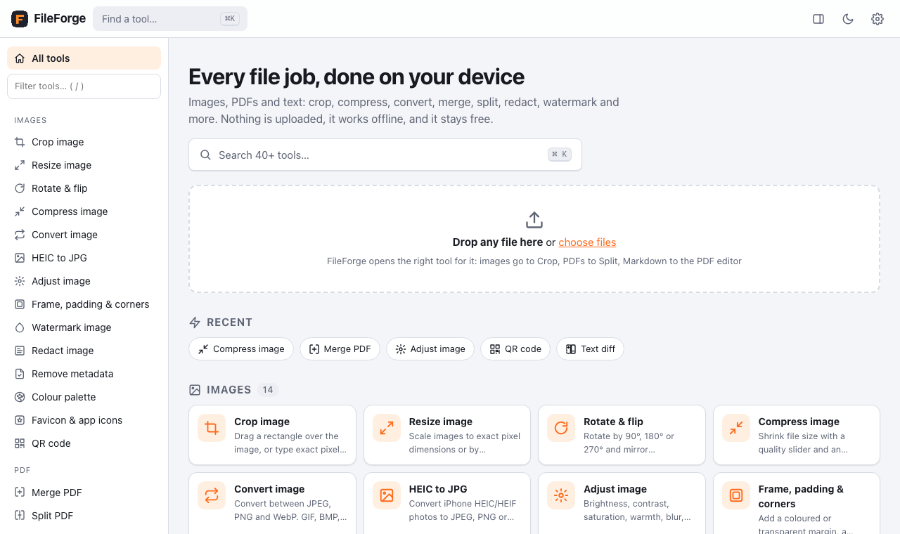
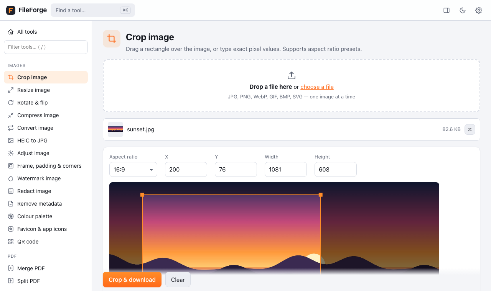

# FileForge

[](https://chromewebstore.google.com/detail/lmnnhcoblacbhagicaambfbbmbpnachn)
[](https://chromewebstore.google.com/detail/lmnnhcoblacbhagicaambfbbmbpnachn)
[](https://addons.mozilla.org/firefox/addon/fileforge-image-pdf-file-tools/)
[](https://addons.mozilla.org/firefox/addon/fileforge-image-pdf-file-tools/)
[](https://github.com/andronaft/FileForge/releases/latest)
[](https://github.com/andronaft/FileForge/actions/workflows/ci.yml)
[](LICENSE)

Local-first file tools for the browser: crop, resize, rotate, compress and convert images (including HEIC), merge/split/rotate PDFs, turn Markdown into PDF, convert CSV ⇄ JSON. 64 tools, everything runs on your device. Nothing is uploaded anywhere.

## Install

| | |
| --- | --- |
| **Chrome, Edge, Brave, Opera** | [Chrome Web Store](https://chromewebstore.google.com/detail/lmnnhcoblacbhagicaambfbbmbpnachn) |
| **Firefox** | [Firefox Add-ons](https://addons.mozilla.org/firefox/addon/fileforge-image-pdf-file-tools/) |
| **Any browser, no install** | [andronaft.github.io/FileForge](https://andronaft.github.io/FileForge/) — installable as an app, works offline |

After installing: click the toolbar icon or press **Alt+Shift+F**, right-click any image → **Edit image in FileForge**, or right-click a PDF link → **Open PDF in FileForge**.

Prefer it small? The ◨ button in the top bar (or right-click the toolbar icon → **Open in side panel**) moves FileForge into the browser's side panel (Chrome, Edge, Brave, Opera) or sidebar (Firefox), beside the page you are working on. The right-click menu items then open files there too. ⧉ sends it back to a full tab. The web version opens a small pop-up window instead.





## Tools

64 tools, all running in the page. Drop a folder or a ZIP into any tool and the files inside go straight in. Open the app and press **⌘K / Ctrl+K** to search them.

| Group | Tool | What it does |
| --- | --- | --- |
| Images | Crop | Drag a rectangle or type exact pixels, aspect-ratio presets |
| Images | Annotate screenshot | Arrows, boxes, circles, highlighter, pen, text and numbered steps; undo/redo; paste a screenshot with Ctrl+V |
| Images | ID & passport photo | 35 × 45, 3 × 4, 2 × 2 in and more with head-position guides; one photo, a 10 × 15 print sheet or an A4 PDF |
| Images | Scan document photo | Finds the sheet's corners, straightens the perspective, whitens the paper (colour, grey or B&W) and saves all pages as one PDF |
| Images | Image to text (OCR) | Reads photos, screenshots and scanned PDFs (English and Ukrainian built in, other languages from a .traineddata file); .txt or a searchable PDF that keeps the original pages |
| Images | Transparent background | Makes a plain single-colour background transparent (logos, signatures, product shots), edge-connected or everywhere, smooth edges, trim |
| Images | Resize | Pixels or percent, social presets (Instagram, Story, YouTube, Open Graph, LinkedIn…) with cover-crop or fit, batch |
| Images | Rotate & flip | 90° / 180° / 270°, mirror horizontally or vertically, batch |
| Images | Compress | Live before/after preview with the resulting size, quality slider, target size in KB, optional max dimension |
| Images | Convert | JPEG ⇄ PNG ⇄ WebP (GIF, BMP, SVG, AVIF accepted as input) |
| Images | SVG to PNG | Render SVG at an exact width, height or scale, 1×/2×/3× sets, transparent or solid background, PNG / JPEG / WebP |
| Images | HEIC to JPG | iPhone HEIC/HEIF → JPEG, PNG or WebP (libheif WebAssembly in a worker) |
| Images | Adjust | Brightness, contrast, saturation, hue, blur, sharpen, grayscale, sepia; one-click looks; live preview; batch |
| Images | Frame, padding & corners | Coloured or transparent margin, border, rounded corners, soft shadow |
| Images | Collage & contact sheet | Many photos in one grid with a gap, background, rounded cells and optional file names |
| Images | Split into tiles | Rows × columns (Instagram grid, banners) or tiles of a fixed size |
| Images | Compare images | Pixel diff of two screenshots with tolerance, highlighted changes, a percentage and a side-by-side export |
| Images | Watermark | Text in a corner, centred, or tiled diagonally, with live preview |
| Images | Redact | Black out, pixelate or blur parts of a screenshot or photo, as many boxes as you need |
| Images | Remove metadata | Shows camera, date, exposure and GPS (with a map link), then strips EXIF, GPS, XMP, IPTC and comments without re-encoding |
| Images | Colour palette | Dominant colours as HEX / RGB / HSL, CSS variables, JSON and a swatch PNG |
| Images | Favicon & app icons | favicon.ico + PNG set + Apple touch + PWA icons + HTML snippet + webmanifest |
| Images | QR code | Link, text, Wi-Fi, e-mail, phone, SMS or vCard as PNG or SVG, any colours |
| PDF | Merge | Combine PDFs in the order you choose |
| PDF | Split | Extract page ranges (click page thumbnails or type them), every page separately, or chunks of N pages |
| PDF | Sign & fill | Draw, type or upload a signature and place it with text, the date, ticks and crosses anywhere on any PDF, rotated pages included |
| PDF | Reorder pages | Drag page thumbnails into a new order, drop pages, reverse |
| PDF | Rotate | All pages or a selection, several files at once |
| PDF | Delete pages | Remove listed pages |
| PDF | Crop pages | Trim margins by millimetres or auto-detect the printed area |
| PDF | Pages per sheet | 2, 4, 6, 9 or 16 pages per A4 / Letter / A3 sheet, or 1 per sheet to re-flow page sizes |
| PDF | Booklet | Saddle-stitch imposition for double-sided printing, left or right binding, gutter and fold line |
| PDF | Page numbers | Header or footer, several formats, custom start |
| PDF | Watermark | Diagonal text such as DRAFT or CONFIDENTIAL on every page |
| PDF | Stamp image or signature | PNG/JPG on all, first, last or chosen pages; position, size, opacity |
| PDF | Fill PDF form | Text fields, checkboxes, radio groups and dropdowns of a fillable PDF; save filled or flattened |
| PDF | Compress | Lossless (compact structure, drop metadata, text stays) or re-render pages as JPEG for scans |
| PDF | Remove metadata | Shows and strips title, author, software, dates, keywords and XMP |
| PDF | Images to PDF | One image per page, fit-to-image or A4 / Letter with margins |
| PDF | PDF to images | PNG or JPEG at 72 / 150 / 300 dpi |
| PDF | Extract images | The pictures embedded in a PDF at their original resolution |
| PDF | PDF to text | Text layer as .txt or Markdown with a heading per page, wrapped lines re-joined |
| PDF | Protect PDF | Password to open (AES-256) and permissions for printing, copying and editing |
| PDF | Unlock PDF | Removes the password (you type it once) and lifts print / copy / edit restrictions |
| PDF | Repair PDF | Rebuilds damaged or cut-off files, optional web optimisation (linearise) |
| PDF | Redact PDF | Draw boxes or find a word; marked pages are rebuilt as images so the text is really gone |
| PDF | Compare PDFs | Text diff of two versions with the pages that changed, saved as a .diff report |
| Text & data | Markdown to PDF | Live preview, three stylesheets, A4 / Letter, print-to-PDF or HTML download |
| Text & data | Markdown to HTML | Standalone page with a stylesheet or a bare HTML fragment |
| Text & data | CSV ⇄ JSON | Auto-detects direction and delimiter, handles quoted cells |
| Text & data | Table converter | CSV / TSV / Markdown / HTML / JSON in; Markdown table, CSV, TSV, HTML, JSON or SQL INSERTs out |
| Text & data | JSON format | Pretty / minify, sort keys, points at the exact error position |
| Text & data | Base64 | Encode text or any file (optionally as a data: URL), decode to text or file |
| Text & data | Text diff | Line-by-line comparison of two texts or files, unified .diff export |
| Text & data | Checksums & hashes | SHA-256, SHA-1, SHA-512, MD5, CRC32 of files or text, verify against an expected value |
| Text & data | Word count & case | Characters, words, sentences, reading time; UPPER / Title / camelCase / snake_case…; trim, dedupe, sort lines |
| Text & data | JWT decoder | Header, payload, readable dates, expiry check, optional HS256/384/512 verification |
| Text & data | URL encode, decode & parse | Percent-encoding both ways, URL parts and query parameters in a table |
| Text & data | Regex tester | Live highlighted matches, groups, replacement preview |
| Text & data | Colour converter & contrast | HEX / RGB / HSL / HSV, tints, shades, complement, CSS variables, WCAG contrast with AA / AAA verdicts |
| Files | Rename files | Batch rename with {name} {n} {date} {time} {ext} patterns, find & replace (regex), case, Latin-only transliteration |
| Files | Create ZIP | Pack files or a whole folder into one archive, three compression levels |
| Files | Extract ZIP | Lists what is inside, extracts everything or names that match, results go straight into other tools |
| Batch | Pipeline | Chain tools (resize → adjust → watermark → compress, merge → page numbers → compress) and run them on every file |

Results can be previewed in place, handed straight to another tool ("Continue with"), downloaded as a single ZIP or copied to the clipboard. The file list shows thumbnails and can be reordered by dragging or sorted by name or date. Images can be pasted from the clipboard, dropped anywhere on the page, or opened from the OS "Open with" menu when the web version is installed as an app. Batches show a progress bar with a Cancel button, Ctrl/⌘+Enter runs the tool, and every tool remembers the options you used last time.

The interface is in English and Ukrainian (picked from the browser language, switchable in Settings), with a light and a dark theme, a home page with every tool, a command palette (⌘K), keyboard shortcuts (`?`), favourite tools pinned to the home page and sidebar, and a compact layout for the browser's side panel.

## Run from source (unpacked)

1. Open `chrome://extensions` and switch on **Developer mode**.
2. Click **Load unpacked** and choose this folder (for Firefox: `about:debugging` → **Load Temporary Add-on** → `dist/firefox/manifest.json` after `python3 scripts/package.py`).
3. Click the FileForge icon in the toolbar, or right-click an image on any page and pick **Edit image in FileForge**.

The context menu asks for permission to read images from that site only when you first use it. The extension requests no host permissions up front.

## Run as a web app

Any static server works. For example:

```bash
python3 -m http.server 8765
```

Then open `http://localhost:8765/app/index.html`.

## Package for the stores

```bash
python3 scripts/package.py
```

This writes `dist/fileforge-chrome-<version>.zip` and `dist/fileforge-firefox-<version>.zip`. The Firefox build swaps the background service worker for an event page, moves the optional host permission to `optional_permissions`, adds the Gecko add-on id, replaces Chrome's `side_panel` with `sidebar_action`.

## Project layout

```
manifest.json        Chrome extension manifest (Manifest V3)
background.js        Service worker: toolbar button + image context menu
app/index.html       The app shell
app/app.js           Home page, search, router, drop zone, file list, results, settings
app/i18n.js, app/i18n/uk.js  UI language: English strings in the code, Ukrainian dictionary
app/icons.js         Inline SVG icons
app/util.js          Shared helpers (download, zip, page ranges, widgets)
app/tools/image.js   Canvas-based image pipeline and the image tools (incl. adjust, frame, collage, compare, SVG, QR)
app/tools/pdf.js     PDF tools built on pdf-lib and pdf.js
app/tools/markdown.js Markdown → PDF / HTML using marked
app/tools/data.js    CSV ⇄ JSON, table converter, JSON format, Base64
app/tools/text.js    Diff, checksums, word count & case, JWT, URL, regex, colour
app/tools/files.js   Rename files, create and extract ZIP
app/tools/photo.js   Annotate, ID photo, document scan, transparent background
app/tools/ocr.js     Image / scanned PDF to text and searchable PDF (Tesseract)
app/tools/pdf-more.js Protect, unlock, repair (qpdf), redact and compare PDFs
app/qpdf*.js         qpdf (WebAssembly) in a worker: passwords, permissions, repair
app/tools/pipeline.js Chains other tools
app/heic*.js         HEIC/HEIF decoding: libheif (WebAssembly) in a worker, shared by every image tool
scripts/package.py   Builds Chrome and Firefox zips
vendor/              pdf-lib, fontkit, pdf.js, marked, JSZip, libheif-js, qpdf, Tesseract (vendor/ocr), qrcode-generator, Noto Sans subset (vendored, no build step)
icons/               Extension icons (generated by scripts/make_icons.py)
```

No build step, no framework, no dependencies to install.

## Limits

- Everything runs in browser memory. Very large files (hundreds of MB) may be slow or fail.
- "Compress PDF" rasterises pages, so text stops being selectable. Use it for scans and photo PDFs.
- DOCX ⇄ PDF is not implemented (needs a server-side converter).
- OCR ships with English and Ukrainian. Other languages need a `.traineddata` file (from Tesseract's tessdata) added in the tool; handwriting is not recognised.
- "Unlock PDF" removes a password you know; it does not guess or crack passwords.

## Web version

<https://andronaft.github.io/FileForge/> is the same app without the extension parts, deployed from `main`
by the [pages workflow](.github/workflows/pages.yml). The privacy policy the stores link to is
<https://andronaft.github.io/FileForge/privacy.html>.

## Publishing

See [docs/PUBLISHING.md](docs/PUBLISHING.md): a `vX.Y.Z` tag (or **Actions → release → Run workflow**)
builds both zips, creates a [GitHub Release](https://github.com/andronaft/FileForge/releases) and submits them
to the [Chrome Web Store](https://chromewebstore.google.com/detail/lmnnhcoblacbhagicaambfbbmbpnachn) and [addons.mozilla.org](https://addons.mozilla.org/firefox/addon/fileforge-image-pdf-file-tools/).
Store listing text: [docs/store-listing.md](docs/store-listing.md); changes per version: [CHANGELOG.md](CHANGELOG.md).

Why I built it: [I stopped uploading my files to random converter sites](https://zhukovskyi.space/blog/fileforge/). Made by [Andrii Zhukovskyi](https://zhukovskyi.space/).

## Privacy

See [PRIVACY.md](PRIVACY.md). Short version: no uploads, no accounts, no analytics.

## Third-party licenses

- [pdf-lib](https://github.com/Hopding/pdf-lib) — MIT
- [marked](https://github.com/markedjs/marked) — MIT
- [JSZip](https://github.com/Stuk/jszip) — MIT or GPLv3
- [pdf.js](https://github.com/mozilla/pdf.js) — Apache 2.0
- [libheif-js](https://github.com/catdad-experiments/libheif-js) — LGPL-3.0 (libheif and libde265, see `vendor/libheif.LICENSE`)
- [qpdf](https://github.com/qpdf/qpdf) 12.2 — Apache 2.0, WebAssembly build from [qpdf-wasm](https://github.com/neslinesli93/qpdf-wasm) (ISC)
- [tesseract.js](https://github.com/naptha/tesseract.js) and [tesseract.js-core](https://github.com/naptha/tesseract.js-core) — Apache 2.0, with `eng` and `ukr` models from tessdata (Apache 2.0); the CDN defaults are patched out, see `vendor/ocr/README.md`
